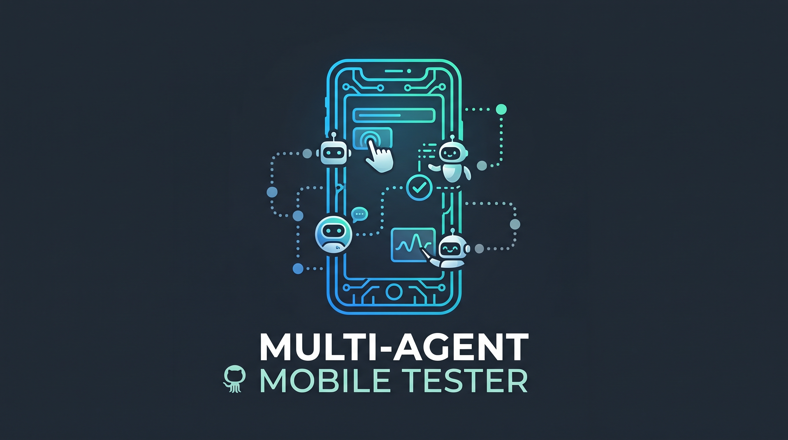
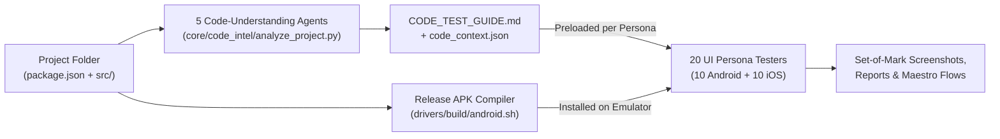
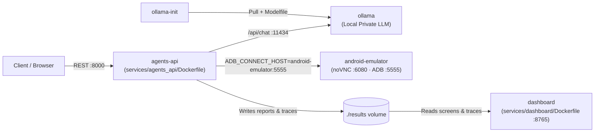

# Multi-Agents-Mobile-Testers

<p align="center">
  
</p>

Run **25 autonomous AI agents** (5 Code-Understanding Agents + 20 Persona UI Testers) on local Android Emulators and iOS Simulators powered **100% by your local Ollama LLM**—with **zero cloud inference, zero external API keys, and complete data privacy**.

---

## Privacy First: 100% Local AI with Ollama

Testing pre-release mobile applications often exposes proprietary source code, internal API endpoints, staging credentials, and unreleased UI screens. **Multi-Agents-Mobile-Testers** keeps your entire QA workflow strictly inside your machine or private Docker network by running all vision and code-reasoning models on **local Ollama** (`qwen2.5vl:7b` / `qwen2.5vl-32k`):

- **Source Code Never Leaves Your Machine:** When you point the tool at a project folder containing `package.json`, all 5 Code-Understanding Agents analyze your routes, forms, state stores, and manifests locally without uploading repositories to third-party SaaS LLMs.
- **Screenshots & UI Trees Stay Local:** Every emulator/simulator screenshot (`*.png`), Set-of-Mark overlay (`*.som.png`), and accessibility dump is processed locally between your agent runtime and `OLLAMA_HOST` (`http://localhost:11434` or the internal `ollama` container).
- **No Secret Leakage in Recorded Traces or Replays:** User inputs and credentials typed during exploration are stripped out of `trace.json` into git-ignored `trace.params.json` placeholders (`TEXT_1`, `TEXT_2`). The local dashboard binds to `127.0.0.1` by default and never serves `trace.params.json`, while deterministic Maestro replays run completely model-free (`OLLAMA_*`, tokens, and keys scrubbed).
- **Opt-In Telemetry Only:** External tracing (`LANGCHAIN_TRACING_V2`) defaults to `false` so zero prompts, screenshots, or reports leave your environment unless you explicitly opt in.

---

## Key Capabilities

- **Code-Aware Pre-Analysis (`package.json` Support):** Point `--app-dir` at your React Native, Expo, or Capacitor project folder before compiling the release `.apk` so automated testers already know every screen, route, form validation rule, and `testID` ([core/code_intel/analyze_project.py](core/code_intel/analyze_project.py)).
- **Set-of-Mark (SoM) Visual Prompting:** [core/som.py](core/som.py) overlays numbered bounding boxes (`[1]`, `[2]`, ...) onto `<nn>.som.png` and records pixel coordinates in `<nn>.som.json` and `latest_som.json` inside [drivers/android/screen.py](drivers/android/screen.py) and [drivers/ios/screen.py](drivers/ios/screen.py). [services/agents_api/agent.py](services/agents_api/agent.py) sends `.som.png` overlays to your local Ollama vision model and exposes `tap_element(element_id=...)` so the LLM clicks UI controls accurately without guessing raw coordinates.
- **Native Python Maestro Compiler:** [core/trace/maestro_compiler.py](core/trace/maestro_compiler.py) validates and compiles `trace.json` and dashboard checkpoints (`assertVisible` / `assertNotVisible`) directly into `.flow.yaml` Maestro test suites—no Node.js or external Explore-Compile-Replay checkout required. [core/trace/ecr_replay.py](core/trace/ecr_replay.py) automatically uses the native compiler whenever `--ecr` is omitted.
- **Live Dashboard & Run Control Panel:** Launch [services/dashboard/server.py](services/dashboard/server.py) to open **New Run** (select a `package.json` project folder, run **Analyze Code (5 Agents)**, choose `--personas all` or a single persona, and launch runs), **Live Feed** (watch real-time `.som.png` screenshots, tagged element counts, and agent logs), and **Export Maestro YAML** from any screen node ([docs/dashboard.md](docs/dashboard.md)).

---

## 25-Agent Architecture

Instead of testing a compiled `.apk` blind, **Multi-Agents-Mobile-Testers** coordinates **5 Code-Understanding Agents** and **20 Persona UI Tester Agents** across a 3-phase local pipeline:



### Phase 1: 5 Code-Understanding Agents

| Agent # | ID | Role | Extracted Intelligence |
| :--- | :--- | :--- | :--- |
| **1** | `stack-manifest-analyst` | Stack, Config & Manifest Analyst | Detects framework (`react-native`, `expo`, `capacitor`), resolves `app_id`, permissions, dependencies, and entry files. |
| **2** | `navigation-screen-mapper` | Navigation & Screen Cartographer | Maps React Navigation stacks/tabs, Expo Router `app/` routes, screen modules, and navigation targets. |
| **3** | `interaction-form-extractor` | Component, Form & Selector Analyst | Extracts `TextInput`, `Pressable`/`Button`/`Switch`, `testID`, `accessibilityLabel`, placeholders, validation rules, and edge-case inputs. |
| **4** | `state-api-flow-analyst` | State, Auth & Business Logic Analyst | Identifies Redux/Zustand/Context state, `AsyncStorage` keys, API endpoints, demo credentials, auth gates, and user flows. |
| **5** | `qa-strategy-synthesizer` | Lead QA Coordinator | Generates `results/CODE_TEST_GUIDE.md` and code-aware playbooks tailored to all **20 personas**. |

### Phase 2 & 3: 20 Persona UI Testers (10 Android + 10 iOS)

After [drivers/build/android.sh](drivers/build/android.sh) compiles the release `.apk` (or `.app` on macOS), each of the **20 personas** in [config/personas.json](config/personas.json) receives `results/CODE_TEST_GUIDE.md` and its tailored playbook in LangGraph (`load_context`)—covering accessibility font scaling up to 200%, RTL Arabic layouts, dark mode contrast, tablet form factors, and multi-language/Unicode fuzz testing across Android (`eleanor`, `marcus`, `nadia`, `takumi`, `helen`, `carmen`, `arjun`, `arina`, `thiago`, `emre`) and iOS (`camille`, `lukas`, `ethan`, `haruka`, `salma`, `diego`, `erik`, `chiara`, `jihoon`, `chen`).

---

## Prerequisites

1. **Ollama** running locally (`ollama serve`) with a **vision + tool-calling** model:
   ```bash
   ollama pull qwen2.5vl:7b
   ollama create qwen2.5vl-32k -f config/Modelfile
   ```
   Adjust defaults in [config/ollama.env](config/ollama.env) (`OLLAMA_HOST`, `OLLAMA_MODEL`, `OLLAMA_NUM_CTX`, `OLLAMA_TIMEOUT`).
2. **Python 3.9+** dependencies (LangGraph, LangChain Ollama, Pydantic, Pillow, and opt-in LangSmith):
   ```bash
   pip install -r requirements.txt
   ```
3. **Device tooling**:
   - **Android**: Android SDK (`adb`, `emulator`, `aapt2`) with a running Android Emulator.
   - **iOS (macOS only)**: Xcode Simulator (`xcrun simctl`) and AXe (`axe` CLI).

---

## Quick Start

### Bundled Demo App
Start an Android Emulator, ensure Ollama is running, and run:
```bash
./run_local.sh --platform android --personas eleanor --model qwen2.5vl-32k
```

### Run on Your React Native / Expo Project (`package.json`)
Point `--app-dir` to your source project folder to run the **5 Code-Understanding Agents**, compile your **release `.apk`**, and test with **all 20 persona agents** ([briefs/code_aware.md](briefs/code_aware.md)):

```bash
./run_local.sh \
  --platform android \
  --app-dir /path/to/your-react-native-app \
  --personas all \
  --brief briefs/code_aware.md \
  --model qwen2.5vl-32k
```

Or run the 5 Code-Understanding Agents standalone:
```bash
python3 core/code_intel/analyze_project.py \
  --app-dir /path/to/your-react-native-app \
  --out results
```

### Using a Prebuilt `.apk` or iOS Simulator `.app`
```bash
# Android
./run_local.sh \
  --platform android \
  --apk /path/to/app-release.apk \
  --app-id com.yourcompany.yourapp \
  --personas eleanor \
  --model qwen2.5vl-32k

# iOS Simulator (macOS)
./run_local.sh \
  --platform ios \
  --ios-app /path/to/YourApp.app \
  --app-id com.yourcompany.yourapp \
  --personas camille \
  --model qwen2.5vl-32k
```

---

## View Results, Dashboard & Native Maestro Export

- Per-persona reports, Set-of-Mark overlays (`*.som.png`), code intelligence (`CODE_TEST_GUIDE.md`, `code_context.json`), and JSON findings are saved under `results/`.
- A consolidated report is written to `results/SUMMARY.md`.
- Launch the interactive **Live Dashboard & Run Control Panel**:
  ```bash
  python3 services/dashboard/server.py results --allow-empty
  ```
- Compile any `trace.json` natively to Maestro YAML without external Node dependencies ([docs/replay.md](docs/replay.md)):
  ```bash
  python3 core/trace/maestro_compiler.py results/<persona>/trace.json
  python3 core/trace/ecr_replay.py results/<persona> --persona <persona>
  ```

---

## Docker & Docker Compose Microservice Architecture

Run the entire stack—including the **containerized Android 14 emulator** (`android-emulator`), `ollama`, `ollama-init`, `agents-api`, and `dashboard`—with a **single command**:

```bash
docker compose up --build
```



- **Dashboard UI & Run Control Panel:** `http://127.0.0.1:8765`
- **Containerized Android Screen (noVNC):** `http://localhost:6080`
- **REST API:** `http://localhost:8000`
- **Requirements:** Linux host with `/dev/kvm` enabled for `android-emulator`. (To connect to a host-side emulator instead, set `ADB_CONNECT_HOST=host.docker.internal:5555`.)

### Trigger Code Analysis & Test Runs via REST API (`:8000`)
```bash
# Health check
curl http://localhost:8000/health

# Run the 5 Code-Understanding Agents on a project folder with package.json
curl -X POST http://localhost:8000/analyze \
  -H "Content-Type: application/json" \
  -d '{"app_dir":"demo-app"}'

# Retrieve generated code intelligence
curl http://localhost:8000/code-context

# Start a test run
curl -X POST http://localhost:8000/runs \
  -H "Content-Type: application/json" \
  -d '{"platform":"android","app_dir":"demo-app","personas":"all","model":"qwen2.5vl-32k"}'

# Check run status & findings
curl http://localhost:8000/runs/run-1

# Generate consolidated summary (results/SUMMARY.md)
curl -X POST http://localhost:8000/summarize -H "Content-Type: application/json" -d '{}'
```

Open the dashboard at **http://127.0.0.1:8765**.

---

## Key Files

- [run_local.sh](run_local.sh) — Orchestrates Phase 1 (5 Code-Understanding Agents), Phase 2 (Release APK/app compilation), and Phase 3 (Persona QA runs).
- [core/code_intel/analyze_project.py](core/code_intel/analyze_project.py) — 5 Code-Understanding Agents inspecting `package.json`, routes, forms, and state to guide all 20 personas.
- [core/som.py](core/som.py) — Set-of-Mark (`*.som.png` / `*.som.json`) bounding-box generator and `tap_element` resolver.
- [core/trace/maestro_compiler.py](core/trace/maestro_compiler.py) — Native Python compiler from `trace.json` to Maestro `.flow.yaml`.
- [services/agents_api/](services/agents_api/) — LangGraph 5-node state machine (`agent.py`), REST API microservice (`server.py`), Pydantic schemas (`schemas.py`), status reporter (`status.py`), and `Dockerfile`.
- [services/dashboard/](services/dashboard/) — Visual screen map, Live Run Control & Set-of-Mark Feed server (`server.py`), static UI (`static/`), and `Dockerfile`.
- [drivers/](drivers/) — App build scripts (`build/`), Android emulator tools (`android/`), and iOS Simulator tools (`ios/`).
- [config/](config/) — [config/personas.json](config/personas.json), [config/ollama.env](config/ollama.env), and [config/Modelfile](config/Modelfile).
- [briefs/](briefs/) — [briefs/code_aware.md](briefs/code_aware.md), [briefs/default.md](briefs/default.md), and specialized exploration/reproduction/mapping briefs.
- [docker-compose.yml](docker-compose.yml) — Containerized microservice stack (`ollama`, `ollama-init`, `agents-api`, `dashboard`, `android-emulator`).
- [requirements.txt](requirements.txt) — Python packages (`langgraph`, `langchain-ollama`, `langchain-core`, `pydantic`, `langsmith`, `pillow`).
